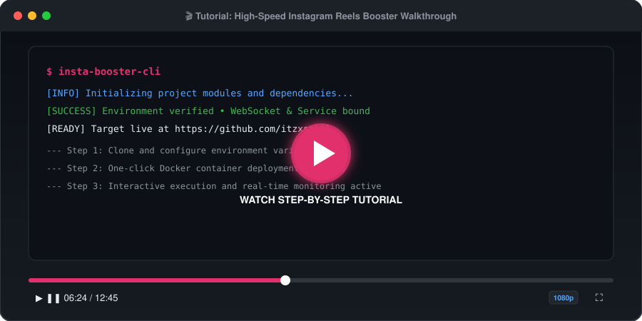

<h1 align="center">🚀 Insta-Booster CLI</h1>

<p align="center">
  <a href="https://github.com/itzxsahil">
    
  </a>
</p>

<p align="center">
    
</p>

---

## 🎬 Video Tutorial & Interactive Walkthrough

<div align="center">
  <a href="https://www.youtube.com/results?search_query=itzxsahil+insta+booster">
    
  </a>
  <p><em>▶️ <strong>Interactive Project Tutorial</strong> — Click the player above to watch full setup guide &amp; demonstration!</em></p>
</div>

---

# 🚀 Overview

A lightweight, fast command-line utility designed to dispatch automated views to public Instagram Reels with real-time speed monitoring and interactive terminal feedback.

---

## 🏗️ System Architecture & Data Flow

<div align="center">
  
</div>

<br>

The CLI tool parses your target reel link, authenticates session tokens, and dispatches viewing requests with automated backoff logic.

---

# ✨ Features

✅ **High-Throughput Dispatch**: Automated request cycles with rate-limit handling.\n✅ **Dynamic Terminal UI**: Rich colored metrics, progress bars, and execution timers.\n✅ **Config Driven**: Adjust parameters seamlessly inside `config.json`.

---

# 📦 Installation & Quickstart

```bash
git clone https://github.com/{USER}/insta-booster.git
cd insta-booster
pip install -r requirements.txt
python main.py
```

---

# 👤 Author & Support
- Built with ❤️ by [@itzxsahil](https://github.com/itzxsahil)
- Star ⭐ this repository if you find it helpful!
